# Kanban educatiu

Una aplicació Kanban pensada per als projectes de formació professional. El
professorat defineix **una sola vegada** les tasques d'un projecte; cada grup
d'alumnes rep les mateixes tasques, en el mateix ordre, i en segueix el
progrés en un tauler propi.

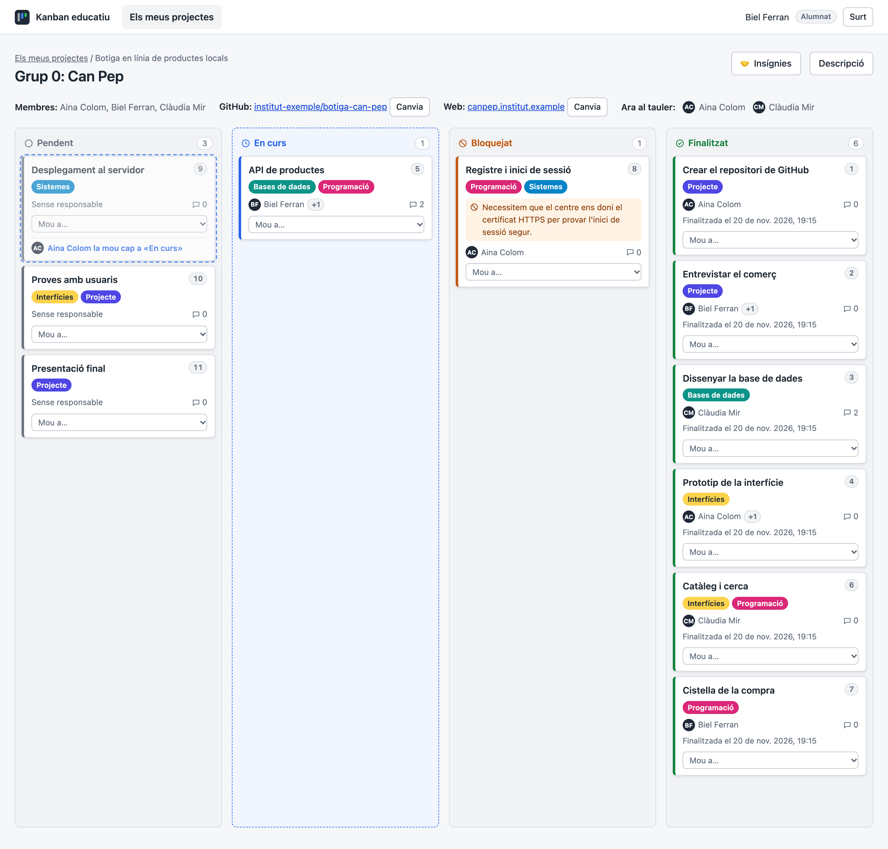

- **Alumnat**: treballa al tauler del seu grup, es fa responsable de tasques,
  hi afegeix col·laboradors, comenta i avisa quan una tasca queda bloquejada.
- **Professorat**: crea projectes, tasques i grups, i veu d'un cop d'ull com
  avança cada grup i què ha fet cada alumne.
- **Administració**: gestiona els comptes i supervisa tots els projectes.

La interfície és íntegrament en **català**. El codi, la base de dades i la
[documentació d'arquitectura](docs/architecture.md) són en anglès.

> Totes les captures d'aquest document s'han fet amb dades inventades:
> les persones, els correus, els projectes i els repositoris no existeixen.

## Continguts

1. [Un passeig per l'eina](#un-passeig-per-leina)
2. [Com funciona](#com-funciona)
3. [Rols i permisos](#rols-i-permisos)
4. [Tecnologia](#tecnologia)
5. [Posada en marxa en local](#posada-en-marxa-en-local)
6. [Configuració (.env)](#configuració-env)
7. [Inici de sessió institucional](#inici-de-sessió-institucional)
8. [La primera persona administradora](#la-primera-persona-administradora)
9. [Proves automàtiques](#proves-automàtiques)
10. [Desplegament en producció](#desplegament-en-producció)
11. [Seguretat](#seguretat)
12. [API REST](#api-rest)
13. [Estructura del repositori](#estructura-del-repositori)

## Un passeig per l'eina

### Entrada

S'hi entra amb el compte institucional (Google Workspace o Microsoft Entra ID).
Qui ho prefereixi pot definir una contrasenya al seu perfil i entrar amb el
correu.

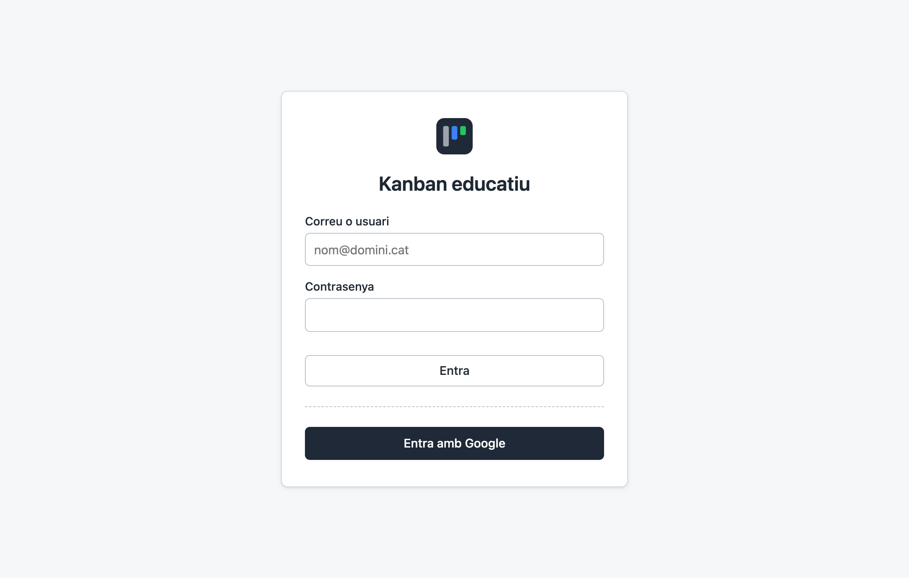

### Projectes

Cada persona veu només els seus projectes: el professorat, els que ha creat o
on té docència assignada; l'alumnat, aquells on forma part d'un grup. Els
projectes arxivats queden amagats darrere d'un interruptor.

Un projecte es pot ocultar a l'alumnat mentre es prepara («Oculta el projecte
a l'alumnat», a «Edita el projecte»): l'alumnat no el veu ni hi pot entrar, i
el professorat hi veu l'etiqueta «Ocult als estudiants». Els projectes nous i
les còpies comencen ocults.

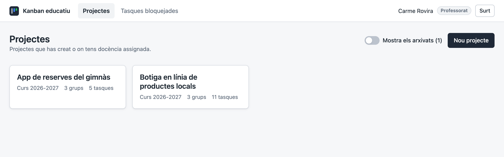

### Matriu de progrés

És la primera pantalla que veu el professorat en obrir un projecte: una fila
per grup i una columna per tasca, amb l'estat de cadascuna. Es pot filtrar
per etiqueta.

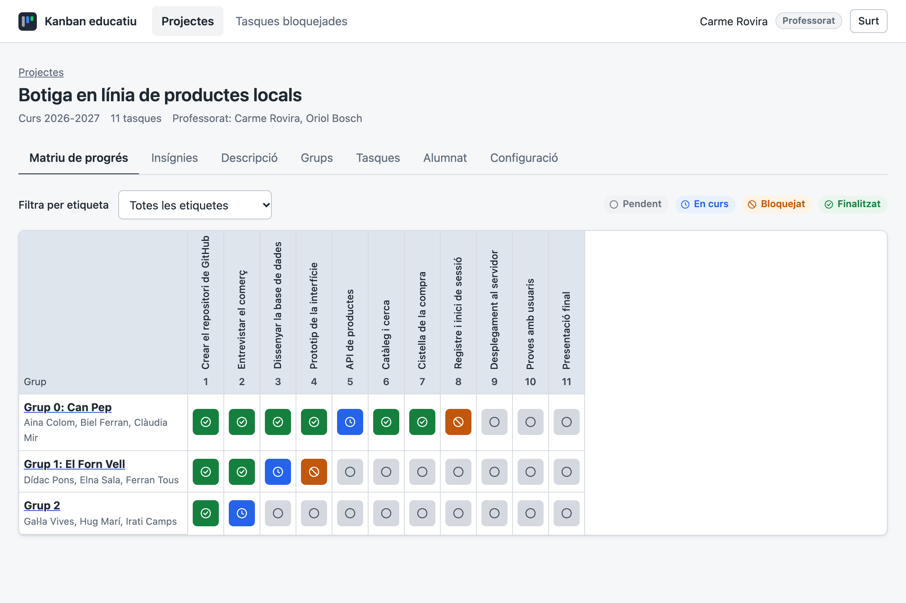

### Tasques compartides

Les tasques es defineixen una vegada per a tot el projecte, amb una descripció
en Markdown i etiquetes de colors. L'ordre de la llista és la prioritat: no hi
ha nivells de prioritat a part. Per canviar-lo, s'arrossega la tasca pel
cercle que té a l'esquerra fins a la nova posició, o es fan servir les fletxes
de sobre i de sota del cercle. També es poden importar d'un fitxer Markdown.

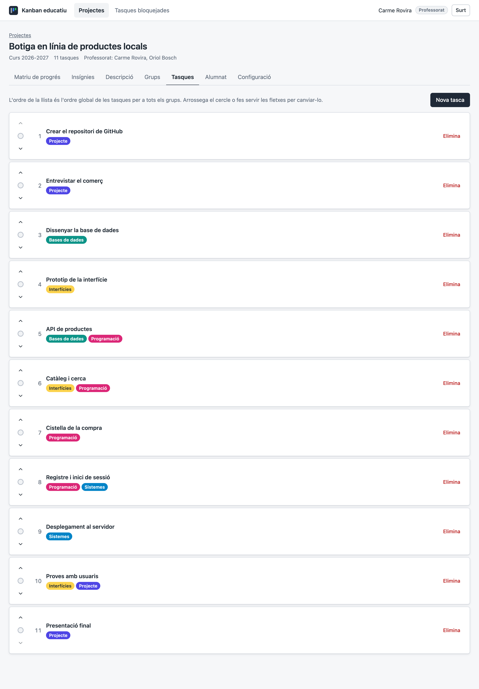

### Grups

Els grups s'omplen escrivint el correu institucional de cada alumne. Cada grup
té el seu tauler, una barra que en resumeix el progrés i, si l'alumnat els ha
configurat, l'enllaç al repositori de GitHub i a la web on publica la feina.
A més del número, un grup pot tenir un nom curt opcional.

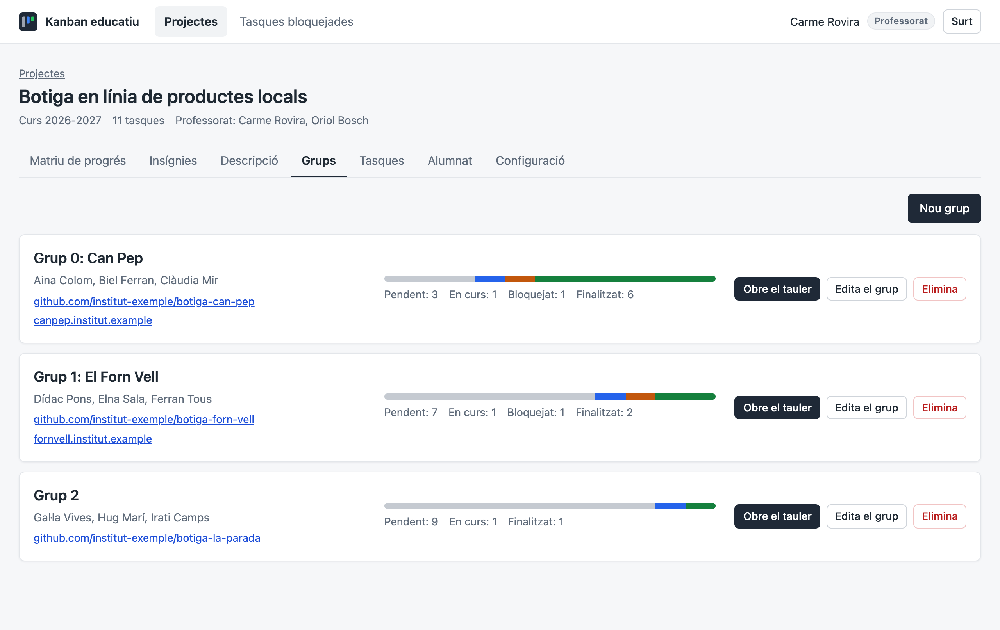

### Tauler del grup

L'alumnat mou les tasques entre les columnes. Qui comença una tasca sense
responsable en queda com a responsable automàticament. Una tasca bloquejada
mostra el motiu a la mateixa targeta. Cada targeta porta, a la cantonada de
dalt a la dreta, el número de la tasca dins del projecte (el mateix de la
llista de tasques i de la matriu), també quan ja és a «Finalitzat». Des del tauler, el grup configura el seu
repositori de GitHub i l'adreça de la seva web.

El tauler s'actualitza sol, en temps real: quan algú mou una tasca, la resta
de persones que tenen el tauler obert la veuen canviar de columna sense
recarregar la pàgina. També es veu qui més hi ha al tauler («Ara al tauler»)
i, mentre algú arrossega una targeta, aquesta queda marcada a les altres
pantalles amb el seu nom i la columna cap on la porta. És només un avís: si
dues persones mouen la mateixa tasca alhora, continua guanyant la primera i
la segona rep un missatge.

La resta de pantalles també es mantenen al dia soles: la matriu de progrés,
les insígnies, la llista de tasques bloquejades i el detall d'una tasca
oberta, que es torna a carregar sense perdre el comentari que s'hi estigui
escrivint.


### Detall d'una tasca

Cada tasca té la descripció, els comentaris, els bloquejos i l'historial
complet de tot el que hi ha passat. La persona responsable pot traspassar-la
a un company o afegir-hi col·laboradors.

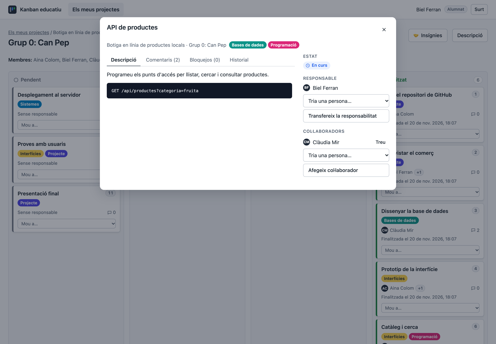

### Tasques bloquejades

El professorat té una pantalla amb totes les tasques bloquejades dels seus
projectes, amb el motiu i el temps que fa que estan aturades.

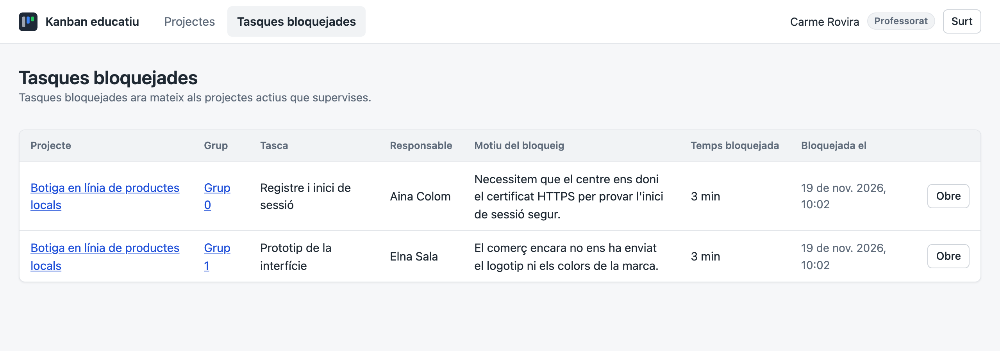

### Activitat de cada alumne

Ser responsable d'una tasca no demostra haver-ne fet tota la feina. Aquesta
vista separa la responsabilitat de les accions realment registrades: tasques
finalitzades, col·laboracions, comentaris, bloquejos i traspassos.

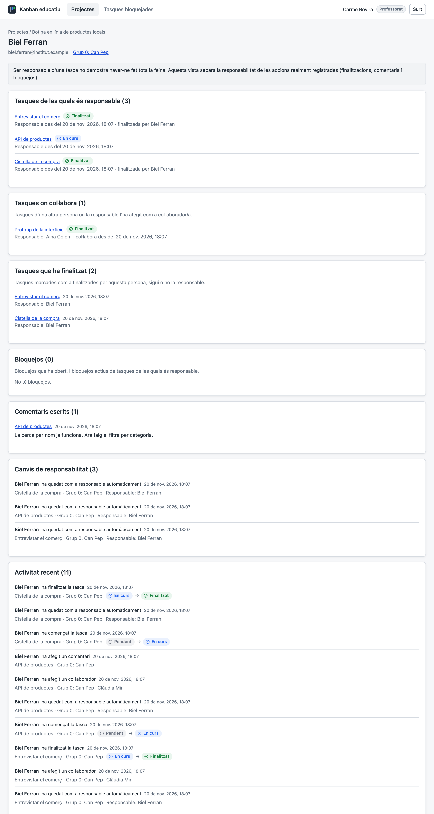

### Insígnies de treball en equip

Una pàgina amb el progrés de tots els grups, la mitjana de la classe i quatre
insígnies que qualsevol grup pot aconseguir. No hi ha classificació ni podi:
les insígnies premien com es reparteix la feina, no qui va més de pressa.

| Insígnia | El grup la té mentre… |
|---|---|
| 🙌 Tothom treballa | Ningú no ha finalitzat menys tasques de les que li tocarien a parts iguals, amb un marge del 15% (com a mínim, d'una tasca). Tothom en té almenys una. |
| ⚖️ Feina ben repartida | Ningú no ha finalitzat més tasques de les que li tocarien a parts iguals, amb un marge del 15% (com a mínim, d'una tasca). |
| 🧩 Polivalents | Cada persona ha finalitzat tasques de, com a mínim, la meitat de les etiquetes que ha treballat el grup. |
| 🧭 Autonomia | Cada persona ha finalitzat pel seu compte, sense col·laboradors, almenys un terç de les seves tasques. |

Per exemple, amb 12 tasques finalitzades entre 3 persones en toquen 4 a
cadascuna, i cada persona en pot tenir entre 3 i 5. Funciona igual per a grups
d'una a sis persones.

Es calculen sobre totes les tasques que el grup ha finalitzat fins ara, no
sobre un nombre fix: comencen a comptar quan hi ha, de mitjana, una tasca
finalitzada per persona, i una insígnia aconseguida es perd si el grup deixa
de treballar així.

El botó «?» de cada insígnia explica com s'aconsegueix i què li falta al grup.
La marca vertical de cada barra és la mitjana de la classe, perquè cada grup
sàpiga si va avançat o endarrerit.

El professorat la veu sempre, a la pestanya «Insígnies» del projecte.
L'alumnat només la veu si està activat «Mostra les insígnies a l'alumnat» a
«Edita el projecte» (els projectes nous el tenen activat); aleshores té un botó «Insígnies»
al seu tauler i veu el nom i el progrés dels altres grups, però no qui en
forma part. Les insígnies es calculen a partir de qui marca cada tasca com a
finalitzada: mostren com es registra la feina, no en mesuren la qualitat.

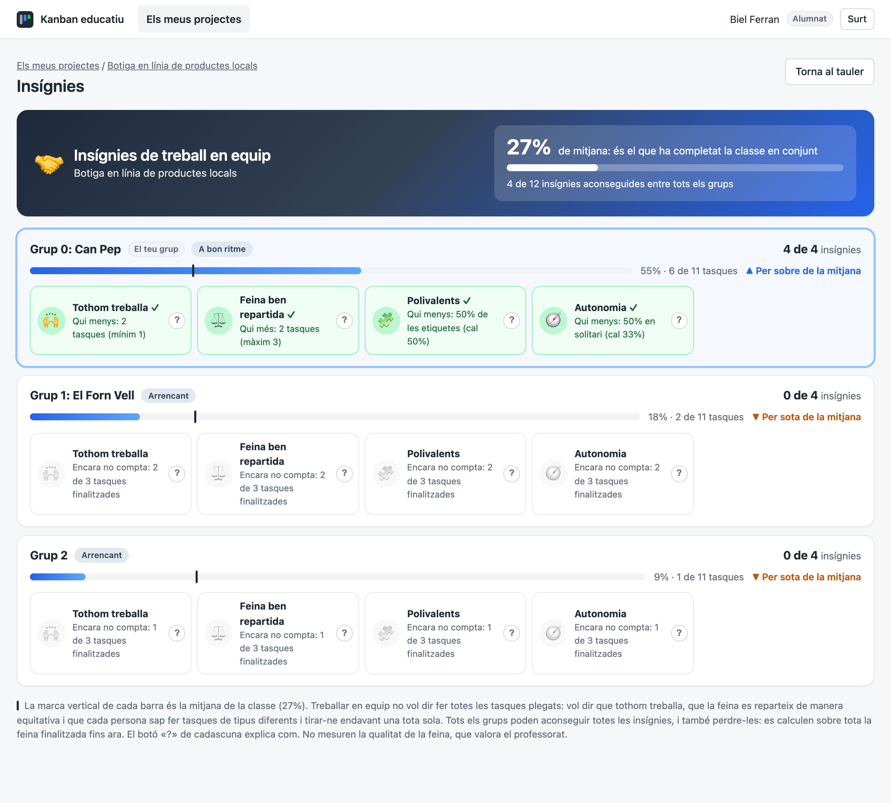

### Usuaris

L'administració aprova els comptes nous, afegeix persones per avançat, en
canvia el rol i les pot desactivar. També pot eliminar un compte que no tingui
activitat registrada; els que en tenen només es poden desactivar, perquè
l'historial conservi qui va fer cada cosa.

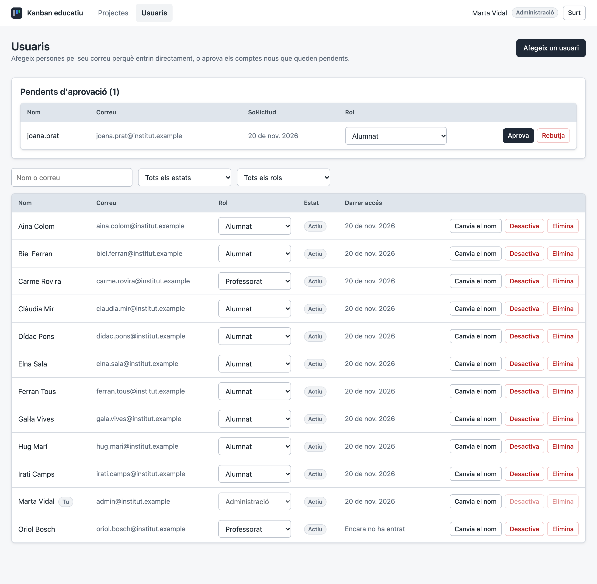

## Com funciona

### Estats i assignació de tasques

Cada grup té el seu propi estat per a cada tasca compartida: **Pendent**,
**En curs**, **Bloquejat** o **Finalitzat**.

```text
Pendent ──▶ En curs ──▶ Finalitzat
              ▲  │  ▲         │
              │  ▼  └─────────┘  (reobrir)
              │ Bloquejat
              └── Pendent (tornar enrere)
```

El professorat i l'administració també poden corregir una tasca a qualsevol
altre estat. Als taulers dels grups entren en mode de només lectura i han
d'activar l'interruptor *Permet l'edició* per fer canvis.

- **La prioritat és la posició a la llista de tasques.** Tots els taulers
  segueixen aquest ordre. L'excepció és la columna *Finalitzat*, que mostra les
  tasques en l'ordre en què s'han acabat.
- **Assignació automàtica**: quan un alumne passa a *En curs* una tasca sense
  responsable, en queda com a responsable en el mateix pas. Dos alumnes que ho
  facin alhora no poden quedar tots dos com a responsables.
- Una tasca té **com a màxim una** persona responsable, que ho continua sent
  encara que la tasca es bloquegi, es finalitzi o es reobri.
- **Col·laboradors**: la persona responsable pot afegir altres membres del
  grup que hi treballen amb ella, i treure'ls. Una tasca sense responsable no
  té col·laboradors.
- **Traspassos**: la persona responsable pot passar la tasca a un altre membre
  del grup. El professorat pot reassignar-la o deixar-la sense responsable.
- **Finalització**: qualsevol membre del grup pot finalitzar una tasca. Qui
  l'ha finalitzada es desa a part de qui n'és responsable.
- **Bloqueig**: cal indicar-ne el motiu. Cada bloqueig es desa amb qui l'ha
  obert, qui l'ha tancat, quan i quant ha durat.
- Totes les accions queden a l'historial de la tasca, que no es pot modificar.

### Etiquetes

Les etiquetes classifiquen i acoloreixen les tasques, i pertanyen a un sol
projecte. Una tasca en pot tenir tantes com calgui, o cap. No donen ni treuen
permisos.

- Es creen escrivint un nom nou mentre s'edita una tasca; l'editor suggereix
  les del projecte i les que la persona ha fet servir en altres projectes.
- Una etiqueta nova rep un color automàticament. Noms, colors i eliminacions
  es gestionen a la pestanya *Configuració* del projecte.
- Eliminar una etiqueta només la treu de les tasques que la tenien.

### Importació de tasques en Markdown

Mentre un projecte **encara no té cap tasca**, se'n pot importar la llista
inicial des d'un document Markdown. La pestanya *Tasques* ofereix la importació
i una plantilla; [examples/tasks-example.md](examples/tasks-example.md) en
mostra el format:

```markdown
## Crear el repositori de GitHub

**Tags:** Programació

Creeu el repositori de GitHub del grup.

---

## Dissenyar la base de dades

**Tags:** Bases de dades, Programació

Creeu l'esquema relacional de la base de dades.

---

## Presentar el projecte

Una tasca sense etiquetes.
```

- Cada títol `##` és una tasca; l'ordre del document és l'ordre global.
- La línia `**Tags:**` és opcional (també s'accepta `**Etiquetes:**`). Les
  etiquetes que el projecte encara no té es creen en importar.
- La resta del text sota el títol és la descripció de la tasca.
- Abans d'importar es mostra una previsualització amb errors i avisos.
- La importació és atòmica: si hi ha algun error, no es crea res.

### Duplicar un projecte

Des de *Configuració* es pot duplicar un projecte per a un altre curs. La
còpia rep el nom i la descripció (editables), les etiquetes i les tasques amb
el seu ordre. **No** rep professorat, grups, alumnat, repositoris, estats,
responsables, comentaris, bloquejos ni historial.

### Arxivar i esborrar projectes

Quan un projecte s'acaba, s'**arxiva**: queda en només lectura, amb tot el seu
historial, sota *Projectes arxivats*, i es pot reactivar.

Només l'administració pot **esborrar** un projecte, i només si ja està
arxivat. Esborrar és definitiu: s'eliminen les tasques, etiquetes, grups,
progrés, comentaris i historial (els comptes d'usuari es conserven).

### Afegir persones

- **Alumnat a un grup**: s'escriu el correu institucional de cada alumne. Si
  encara no té compte, el formulari en demana el nom i el crea; l'alumne ja
  podrà entrar amb aquell correu sense esperar cap aprovació.
- **Professorat a un projecte**: de la mateixa manera, per correu. Un compte
  d'alumne no es converteix mai en professor per aquesta via.
- **Per avançat**: l'administració pot afegir qualsevol persona des
  d'*Usuaris → Afegeix un usuari*, amb nom, correu i rol.
- Qui entra sense haver estat afegit abans queda **pendent d'aprovació**.

## Rols i permisos

| Acció | Administració | Professorat (del projecte) | Alumnat (del grup) |
|---|:-:|:-:|:-:|
| Gestionar usuaris (rols, aprovacions, desactivar i eliminar comptes) | ✔ | | |
| Esborrar definitivament un projecte arxivat | ✔ | | |
| Crear projectes | | ✔ | |
| Editar, arxivar i duplicar un projecte | ✔ | ✔ | |
| Afegir o treure professorat del projecte | ✔ | ✔ | |
| Crear i gestionar les etiquetes | ✔ | ✔ | |
| Crear grups i afegir-hi o treure'n alumnat | ✔ | ✔ | |
| Crear, editar, eliminar i reordenar tasques; importar Markdown | ✔ | ✔ | |
| Veure tots els grups, la matriu i l'activitat de l'alumnat | ✔ | ✔ | |
| Canviar qualsevol estat i reassignar responsables | ✔ | ✔ | |
| Moure tasques pel tauler, bloquejar, desbloquejar i finalitzar | ✔ | ✔ | ✔ |
| Comentar les tasques | ✔ | ✔ | ✔ |
| Traspassar una tasca pròpia a un company del grup | | | ✔ |
| Gestionar els col·laboradors d'una tasca pròpia | ✔ | ✔ | ✔ |
| Configurar el repositori de GitHub i la web del grup | ✔ | | ✔ |
| Veure les insígnies de treball en equip de tots els grups | ✔ | ✔ | Si el projecte les mostra |

L'accés del professorat depèn **només** d'estar assignat al projecte. Qui crea
o duplica un projecte hi queda assignat automàticament, i un professor no es
pot treure a si mateix. Totes les regles es comproven al servidor, no només a
la interfície.

## Tecnologia

| Capa | Tecnologia |
|---|---|
| Servidor | Node.js (mòduls ES) + Express 5 |
| Base de dades | MySQL 8 (InnoDB), amb `mysql2` i consultes parametritzades |
| Autenticació | OpenID Connect (`openid-client`): Google Workspace o Microsoft Entra ID |
| Sessions | `express-session` desades a MySQL |
| Temps real | WebSocket (`ws`) a `/ws`: avisos de canvis, presència i arrossegament en viu |
| Interfície | HTML, CSS i JavaScript sense cap framework ni pas de compilació |
| Markdown | `marked` + `sanitize-html` (es converteix i es neteja al servidor) |
| Proves | L'executor de proves de Node.js (`node --test`) + `supertest` |

## Posada en marxa en local

Cal Node.js 20.12 o posterior i Docker (o un MySQL 8 propi).

```bash
npm install
cp .env.example .env        # i edita'l (vegeu l'apartat següent)
docker compose up -d        # MySQL local
npm run migrate             # crea les taules
npm run dev                 # es reinicia quan canvia un fitxer
```

Obre <http://localhost:3000>.

`docker compose` engega MySQL 8.4 a `127.0.0.1:3307` amb dues bases de dades
buides, `kanban_dev` i `kanban_test`. Els valors del `.env` que hi corresponen:

```dotenv
DB_HOST=127.0.0.1
DB_PORT=3307
DB_NAME=kanban_dev
DB_USER=root
DB_PASSWORD=kanban_root_test
```

Per provar-ho sense proveïdor d'identitat, posa `DEV_AUTH_ENABLED=true`: el
formulari d'entrada accepta qualsevol correu dels dominis permesos sense
contrasenya, amb les mateixes regles de registre i aprovació. **El servidor
es nega a arrencar amb aquesta opció si `NODE_ENV=production`.**

`npm run migrate` aplica els fitxers pendents de `migrations/`. Cal executar-lo
després d'instal·lar i després de cada actualització.

## Configuració (.env)

Tots els valors propis de cada instal·lació i tots els secrets viuen al fitxer
`.env`, que Git ignora. [.env.example](.env.example) en llista totes les
variables. El servidor valida la configuració en arrencar i s'atura si falta
alguna cosa.

| Variable | Per a què serveix |
|---|---|
| `NODE_ENV` | `development`, `production` o `test` |
| `APP_NAME` | Nom que es mostra al títol, la capçalera i la pantalla d'entrada |
| `PORT`, `APP_URL` | Port d'escolta i URL pública |
| `DB_HOST`, `DB_PORT`, `DB_NAME`, `DB_USER`, `DB_PASSWORD` | Connexió a MySQL |
| `OIDC_PROVIDER` | `google` o `microsoft` |
| `OIDC_ISSUER`, `OIDC_CLIENT_ID`, `OIDC_CLIENT_SECRET` | Client del proveïdor d'identitat |
| `OIDC_CALLBACK_URL` | URI de redirecció registrada |
| `ALLOWED_EMAIL_DOMAIN` | Dominis institucionals permesos, separats per comes |
| `INITIAL_ADMIN_EMAIL` | Compte que esdevé administrador en entrar per primer cop |
| `ADMIN_USERNAME`, `ADMIN_PASSWORD` | Administrador opcional amb usuari i contrasenya |
| `SESSION_SECRET` | Com a mínim 32 caràcters aleatoris |
| `DEV_AUTH_ENABLED` | Entrada de desenvolupament, sense proveïdor d'identitat |

Per generar el secret de sessió:

```bash
node -e "console.log(require('crypto').randomBytes(48).toString('hex'))"
```

## Inici de sessió institucional

Només es poden registrar els comptes amb un correu **verificat** d'algun dels
dominis d'`ALLOWED_EMAIL_DOMAIN`. El correu i l'identificador de la persona es
llegeixen sempre del testimoni validat pel servidor, mai del navegador.

### Google Workspace

1. A Google Cloud Console, crea un **ID de client OAuth** de tipus *Aplicació web*.
2. Afegeix-hi la URI de redirecció, per exemple `https://kanban.exemple.cat/auth/callback`.
3. Configura:

```dotenv
OIDC_PROVIDER=google
OIDC_ISSUER=https://accounts.google.com
OIDC_CLIENT_ID=<id de client>
OIDC_CLIENT_SECRET=<secret de client>
OIDC_CALLBACK_URL=https://kanban.exemple.cat/auth/callback
ALLOWED_EMAIL_DOMAIN=exemple.cat
```

### Microsoft Entra ID

1. Registra una aplicació (d'un sol inquilí) amb una URI de redirecció *Web*.
2. Crea-hi un secret de client.
3. Configura:

```dotenv
OIDC_PROVIDER=microsoft
OIDC_ISSUER=https://login.microsoftonline.com/<id-inquilí>/v2.0
OIDC_CLIENT_ID=<id d'aplicació>
OIDC_CLIENT_SECRET=<secret de client>
OIDC_CALLBACK_URL=https://kanban.exemple.cat/auth/callback
```

L'emissor ha de ser el d'un inquilí concret: `common`, `organizations` i
`consumers` es rebutgen.

## La primera persona administradora

Tot compte nou comença com a *pendent* i l'ha d'aprovar algú. Hi ha tres
maneres de tenir la primera persona administradora:

- **Variable d'entorn**: `INITIAL_ADMIN_EMAIL=nom@exemple.cat`. Aquell compte
  passa a ser administrador en entrar per primer cop.
- **Línia d'ordres**, al servidor:

  ```bash
  npm run create-admin -- nom@exemple.cat
  ```

- **Usuari i contrasenya**: amb `ADMIN_USERNAME` i `ADMIN_PASSWORD` al `.env`
  hi ha un administrador integrat que no necessita el proveïdor d'identitat.
  En producció la contrasenya ha de tenir almenys 12 caràcters i no pot
  contenir el nom d'usuari.

La resta d'administradors es nomenen des d'**Usuaris**, dins l'aplicació.

## Proves automàtiques

Les proves fan servir una base de dades i un fitxer de configuració propis,
`.env.test` (ignorat per Git). **No s'executen si `DB_NAME` no acaba en
`_test`**, de manera que mai poden tocar dades reals.

Crea `.env.test`:

```dotenv
NODE_ENV=test
APP_NAME=Kanban de proves
PORT=3999
APP_URL=http://localhost:3999
DB_HOST=127.0.0.1
DB_PORT=3307
DB_NAME=kanban_test
DB_USER=root
DB_PASSWORD=kanban_root_test
ALLOWED_EMAIL_DOMAIN=xtec.cat,iesesteveterradas.cat
SESSION_SECRET=test-session-secret-test-session-secret-0000
ADMIN_USERNAME=admin
ADMIN_PASSWORD=test-admin-password
DEV_AUTH_ENABLED=true
```

I després:

```bash
docker compose up -d
npm test
```

Les proves cobreixen les regles de negoci: aprovació de comptes, accés a
projectes i grups, propagació de les tasques, ordre global, assignació
automàtica, traspassos, col·laboradors, bloquejos, finalització i reobertura,
importació, versions, duplicació, projectes arxivats, contrasenyes i canvis
simultanis.

## Desplegament en producció

Requisits generals:

1. `NODE_ENV=production`, un `SESSION_SECRET` robust, els valors `OIDC_*`
   reals i `DEV_AUTH_ENABLED=false`.
2. Servir l'aplicació darrere d'un servidor intermediari amb HTTPS. Les galetes
   de sessió són `Secure` en producció i l'aplicació confia en un sol salt de
   proxy (`X-Forwarded-*`). El servidor intermediari ha de deixar passar les
   connexions WebSocket de `/ws` (capçaleres `Upgrade`); si no ho fa, els
   taulers continuen funcionant i es refresquen cada 15 segons.
3. `npm ci --omit=dev`, `npm run migrate` i `npm start` sota un gestor de processos.
4. Fer còpies de seguretat de la base de dades amb regularitat.

### Contenidor Proxmox

La carpeta [proxmox/](proxmox) conté els scripts de desplegament en un
contenidor Proxmox.

1. Copia `proxmox/config.env.example` a `proxmox/config.env` i posa-hi el
   port SSH i l'usuari del contenidor. Git ignora aquest fitxer.
2. Crea la configuració del servidor a partir de `.env.example` en un fitxer
   local `kanban.env` (no el pugis al repositori) i envia'l:

   ```bash
   cd proxmox && ./proxmoxSendFile.sh ../kanban.env
   ```

3. Prepara el servidor una sola vegada. Instal·la el que falti (MySQL, Node.js,
   pm2) i crea la base de dades:

   ```bash
   cd proxmox && ./proxmoxInstall.sh
   ```

4. Desplega la branca `main`, ja pujada al repositori:

   ```bash
   cd proxmox && ./proxmoxDeploy.sh
   ```

   L'script empaqueta només els fitxers del repositori, conserva el `.env` del
   servidor, fa una còpia de la base de dades abans de migrar, aplica les
   migracions, reinicia l'aplicació amb pm2, comprova `/health` i torna al
   codi anterior si la versió nova no arrenca.
   `DEPLOY_DRY_RUN=1 ./proxmoxDeploy.sh` només construeix i verifica el paquet.

| Script | Què fa |
|---|---|
| `proxmoxInstall.sh` | Prepara el servidor (un sol cop; demana la contrasenya de sudo) |
| `proxmoxDeploy.sh` | Desplega `main` amb còpia, migracions i comprovació de salut |
| `proxmoxBackup.sh` | Baixa una còpia de la base de dades i del `.env` a `backups/` |
| `proxmoxConnect.sh` | Obre una sessió SSH |
| `proxmoxSendFile.sh` | Copia un fitxer al servidor |
| `proxmoxSetupRedirect80.sh` / `proxmoxSetupRedirectUndo.sh` | Redirigeix el port 80 al port de l'aplicació |
| `proxmoxTunelStart.sh` / `Status` / `Stop` | Túnel SSH cap al MySQL del servidor (port local 3308) |

## Seguretat

- **Contrasenyes**: són opcionals i es desen només com a resums **scrypt** amb
  sal, mai en text pla. La longitud mínima és de 8 caràcters i per canviar-la
  cal l'actual.
- **Intents fallits**: després de 5 intents fallits per a un compte, aquell
  compte queda bloquejat 15 minuts per a l'adreça des d'on s'han fet. La resta
  de persones darrere la mateixa adreça (un centre sencer sovint en comparteix
  una) poden continuar entrant.
- **Sessions**: es desen al servidor, amb galetes `HttpOnly` i `SameSite=Lax`.
  Canviar la contrasenya tanca les altres sessions de la persona.
- **Treure una contrasenya**: l'administració ho pot fer des d'**Usuaris**
  (*Treu la contrasenya*), cosa que també tanca les sessions obertes. Una
  contrasenya continua funcionant encara que la institució tanqui el compte,
  fins que es treu aquí o es desactiva el compte.
- **CSRF**: totes les peticions que modifiquen dades necessiten la capçalera
  `X-CSRF-Token`.
- **Contingut**: el Markdown es neteja al servidor i una política CSP estricta
  impedeix executar scripts externs.
- **Comptes desactivats**: perden l'accés a l'instant, perquè l'usuari es
  torna a llegir de la base de dades a cada petició.
- **Temps real**: el canal WebSocket no porta dades dels taulers ni permet
  modificar res; només avisa que un tauler ha canviat, i cada navegador el
  torna a llegir per l'API amb els seus permisos. Per obrir-lo cal la galeta
  de sessió i que la pàgina sigui la de l'aplicació (capçalera `Origin`). Els
  permisos es tornen a comprovar cada minut i sempre que canvia el projecte, i
  el canal es tanca en sortir de la sessió.

Les decisions de disseny s'expliquen a [docs/architecture.md](docs/architecture.md).

## API REST

Tots els punts d'accés són sota `/api`, retornen JSON i informen dels errors
com a `{ "error": { "code", "message", "details"? } }`. Les peticions que
modifiquen dades necessiten la capçalera `X-CSRF-Token` (el testimoni s'obté
amb `GET /api/session`).

| Àrea | Punts d'accés |
|---|---|
| Autenticació | `GET /auth/login`, `GET <ruta de retorn>`, `POST /auth/password-login`, `POST /auth/logout`, `GET /api/session` |
| Usuaris | `GET /api/users`, `POST /api/users`, `PATCH /api/users/:id`, `POST /api/users/:id/approve`, `POST /api/users/:id/reject`, `DELETE /api/users/:id/password`, `DELETE /api/users/:id`, `POST /api/students/lookup`, `POST /api/teachers/lookup`, `PATCH /api/profile`, `PUT /api/profile/password` |
| Etiquetes | `GET/POST /api/projects/:id/tags`, `GET /api/projects/:id/tags/suggestions`, `PUT/DELETE /api/tags/:id` |
| Projectes | `GET/POST /api/projects`, `GET/PUT/DELETE /api/projects/:id`, `POST …/archive`, `POST …/unarchive`, `POST …/duplicate`, `PUT …/teachers`, `POST …/teachers`, `DELETE …/teachers/:userId` |
| Grups | `POST /api/projects/:id/groups`, `PUT /api/groups/:id/students`, `DELETE /api/groups/:id`, `PUT /api/groups/:id/github`, `PUT /api/groups/:id/web`, `GET /api/groups/:id/board` |
| Tasques compartides | `GET/POST /api/projects/:id/tasks`, `PUT /api/projects/:id/tasks/order`, `GET/PUT/DELETE /api/tasks/:id`, `GET /api/tasks/:id/versions` |
| Importació | `GET /api/projects/:id/import/template`, `POST …/import/preview`, `POST …/import` |
| Tasques de grup | `GET /api/group-tasks/:id`, `POST …/status`, `POST …/responsible`, `POST …/collaborators`, `DELETE …/collaborators/:userId`, `POST …/comments`, `GET …/history` |
| Supervisió | `GET /api/projects/:id/matrix`, `GET /api/projects/:id/ranking`, `GET /api/blocked-tasks`, `GET /api/projects/:id/students/:userId/contributions` |

## Estructura del repositori

```text
├── src/
│   ├── app.js, server.js
│   ├── config/         càrrega i validació de la configuració
│   ├── auth/           flux d'OpenID Connect
│   ├── routes/         taules de rutes
│   ├── controllers/    peticions i respostes HTTP
│   ├── services/       regles de negoci i autorització
│   ├── repositories/   SQL
│   ├── middleware/     usuari de la sessió, CSRF, errors
│   ├── realtime/       canal WebSocket: sales per tauler i avisos de canvis
│   ├── validators/     validació de les dades d'entrada
│   ├── utils/          errors, Markdown, colors
│   └── db/             connexions, migracions, create-admin
├── public/             interfície (HTML, CSS, mòduls JS)
├── migrations/         migracions SQL
├── tests/              proves automàtiques
├── assets/             captures de pantalla d'aquest document
├── docs/architecture.md
├── examples/tasks-example.md
├── proxmox/            scripts de desplegament
├── docker-compose.yml  MySQL local
└── .env.example
```
